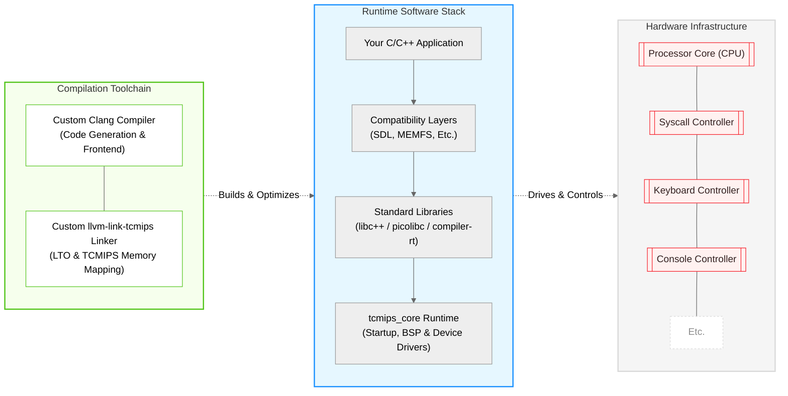

<p align="right">
  <a href="./README.md">简体中文</a> | <b>English</b>
</p>

<p align="center">
  
</p>

## TCMIPS

TCMIPS is a complete C/C++ development ecosystem for the `Turing Complete` sandbox
simulator: write programs in plain standard C/C++, cross-compile them into `.tcm`
binaries, and run them on a custom 32-bit MIPS-compatible CPU architecture inside
the game — or on the bundled desktop emulator. Demos below include Windows 95
(via tiny386), Macintosh (via umac), Doom and SDLPAL.

This repository hosts the full ecosystem: the TCMIPS CPU architecture game save
files, the `tcmips_core` runtime library, ported `picolibc` / `libc++` /
`compiler-rt` standard libraries, and a complete cross toolchain built from a
modified Clang compiler and a custom linker (`llvm-link-tcmips`).

## Features

* **Modified Clang Compiler**: An LLVM/Clang compiler tailored for the TCMIPS
  architecture, supporting its custom instruction encodings, register allocation
  scheme and pipeline design.
* **Custom Linker (`llvm-link-tcmips`)**: A dedicated linker that resolves object
  files and outputs `.tcm` executables formatted for the in-game File Loader
  environment.
* **Desktop Emulator**: Loads and runs `.tcm` images on the host, with pixel/text
  console and keyboard rendering, semihost stdio forwarding, and a GDB/LLDB
  `mipsel-remote` debug stub for interactive debugging.
* **Integrated Core Library (`tcmips_core`)**: A foundational runtime library
  integrating ported picolibc, libc++ and compiler-rt, providing standard C/C++
  runtime features and memory allocation, with full software floating-point and
  64-bit integer arithmetic on the virtual hardware.
* **Dedicated I/O Syscall Interface**: Built-in MIPS syscalls for in-game
  peripherals — campaign I/O, timestamp, seven-segment display, pixel/text
  console, keyboard, palette, and semihost stdio bridge.
* **Graphics & Input Compatibility Layers**: SDL1 / SDL2 compat layers that map
  the SDL API onto the architecture's peripherals, plus `libcg`, a tiny 2D
  graphics library — drop-in porting of SDL-based games and demos.
* **In-Memory File System (`libtcmips_memfs`)**: POSIX-flavoured BSP file layer
  over an in-memory filesystem; file contents burned into the image by the linker
  and accessed at runtime through standard file operations.

## Quick Start

1. Set up the toolchain: download the prebuilt package from the
   [GitHub Releases page](https://github.com/zhangjiantao/tcmips/releases)
   and extract it to any location, such as
   `TCMIPS_TOOLCHAIN_DIR`. Or build it yourself
   (see [Bootstrapping the Toolchain](#bootstrapping-the-toolchain)).

2. Build your C/C++ project:

   ```shell
   cd /path/to/your/project

   cmake -G Ninja -S . -B build \
     -DCMAKE_BUILD_TYPE=Release \
     -DCMAKE_TOOLCHAIN_FILE="$TCMIPS_TOOLCHAIN_DIR/toolchains/cmake/tcmips.toolchain.cmake"
   cmake --build build
   ```

3. Run the resulting `.tcm`: import the save from `/gamesave` and
   load the file in-game via the File Loader, or run it on the
   desktop emulator:

   ```shell
   TCMIPSEmulator <file.tcm>           # opens a window; console/keyboard rendered by the host
   TCMIPSEmulator <file.tcm> -hold=0   # exits automatically when the guest program exits
   ```

   The guest's `printf` output and exit code are forwarded to the
   host (semihost stdio), which makes the emulator well suited for
   scripted runs and testing. For interactive debugging, attach
   gdb/lldb to the emulator's GDB Remote Serial Protocol server
   (`mipsel-remote`) — see `emulator/rsp_stub.c`.

## Known Limitations

- **No C++ exceptions**: the bundled libc++ is built with `-fno-exceptions`;
  any reachable `throw`/`catch` path ends up calling `abort()`. Prefer
  error-code style APIs (`std::error_code` overloads, `errno`).
- **No audio**: the SDL1/SDL2 compatibility layers provide no audio backend
  (stub/dummy implementations), as the platform has no audio peripheral.
- **No threads**: the target is a single-core machine without threading
  support.
- **C++17 recommended**: the bundled libc++ has only partial C++20 support.

## Demo

### Booting Win95 via tiny386


### Booting Macintosh via umac


### Doom


### SDLPAL (palnavy)


More demos: [Bilibili playlist](https://space.bilibili.com/28801454/lists/8407732)

## Repository Structure

- `/tcmips` — Core library integrating runtime libraries and peripheral drivers.
- `/emulator` — Desktop emulator that loads and runs `.tcm` images on the host,
  with pixel/text console and keyboard rendering, plus a GDB/LLDB
  `mipsel-remote` debug stub.
- `/toolchains` — Prebuilt cross-toolchain, CMake toolchain file and sysroot.
- `/tools` — Build-time utilities (font and logo generators).
- `/test` — Assertion-based autotests (see
  [Bootstrapping the Toolchain](#bootstrapping-the-toolchain), step 4).
- `/docs` — Architecture documents: [ISA](docs/TCMIPS-ISA.md),
  [memory layout](docs/TCMIPS-MemoryLayout.md),
  [in-memory file system](docs/TCMIPS-MEMFS.md).
- `/demo` — Sample demos.
- `/examples` — Minimal end-user example project (a `hello` C program) demonstrating
  how to cross-compile a plain C program to a `.tcm` image out of the box.
- `/gamesave` — Game save files for TCMIPS architecture.

## Technology Stack



## Bootstrapping the Toolchain

This section rebuilds the entire suite itself — compiler, linker and
sysroot — from source, and is only needed for toolchain development.
To build C/C++ projects you don't need it; use the prebuilt toolchain
as described in [Quick Start](#quick-start).

### 1. Build LLVM

Build the customized LLVM toolchain by referring to this repository:

[https://github.com/zhangjiantao/tcmips-llvm](https://github.com/zhangjiantao/tcmips-llvm)

### 2. Deploy LLVM Build Artifacts

```shell
# Create target toolchain directory
mkdir -p ./toolchains/llvm/bin

# Copy core compiler and linker
cp ${LLVM_BUILD_PATH}/bin/clang ./toolchains/llvm/bin/
cp ${LLVM_BUILD_PATH}/bin/clang++ ./toolchains/llvm/bin/
cp ${LLVM_BUILD_PATH}/bin/llvm-link-tcmips ./toolchains/llvm/bin/

# Grant executable permission
chmod +x ./toolchains/llvm/bin/*
```

### 3. Build Sysroot

Construct a minimal sysroot that provides the target platform header files and
static libraries needed for cross-compilation.

```shell
cmake -G Ninja -S . -B build -DCMAKE_BUILD_TYPE=Release

cmake --build build --target TCMIPS_CORE_ALL
```

### 4. Run the Tests

The suite self-verifies: guest-side autotests report structured
`[SELF] <name> PASS/FAIL` lines and an exit code through semihost
stdio (methodology in [`AUTOTEST.md`](AUTOTEST.md)).

```shell
# Build all guest test suites
cmake --build build --target AUTOTEST_ALL

# Build the desktop emulator (first time only)
cmake -S emulator -B build-emulator -DCMAKE_BUILD_TYPE=Release
cmake --build build-emulator --target TCMIPSEmulator

# Run every suite; all of them are expected to exit with code 0
for tcm in build/autotest/*.tcm; do
  build-emulator/TCMIPSEmulator "$tcm" -hold=0
done
```

## Related Repositories

* [https://github.com/zhangjiantao/tcmips-llvm](https://github.com/zhangjiantao/tcmips-llvm)

## License

The original code of this repository is released under the MIT License — see
[LICENSE](./LICENSE), which also contains the third-party notices appendix.
Vendored third-party components remain under their own licenses; the
GPL-licensed demos (`demo/doom`, `demo/palnavy`, and the GPL-derived portions of
`demo/umac`) are outside the MIT scope.
