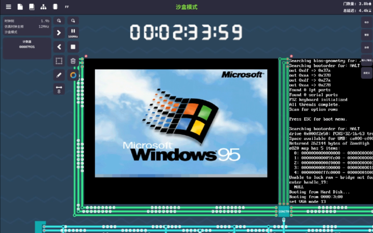
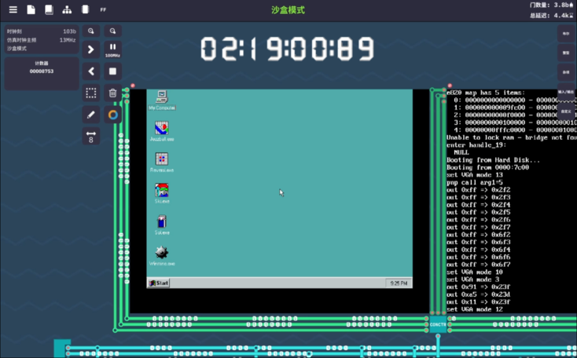
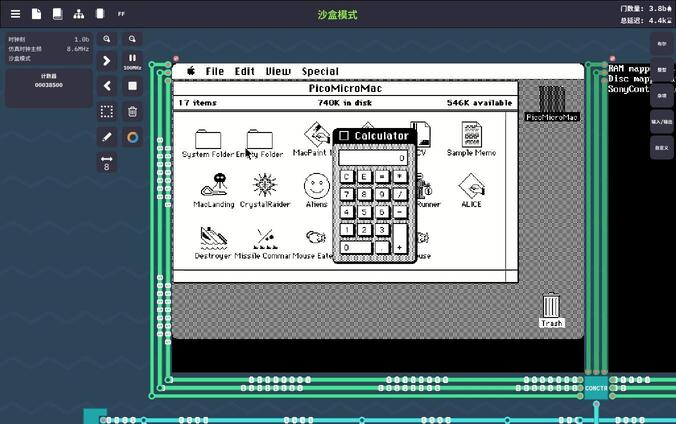
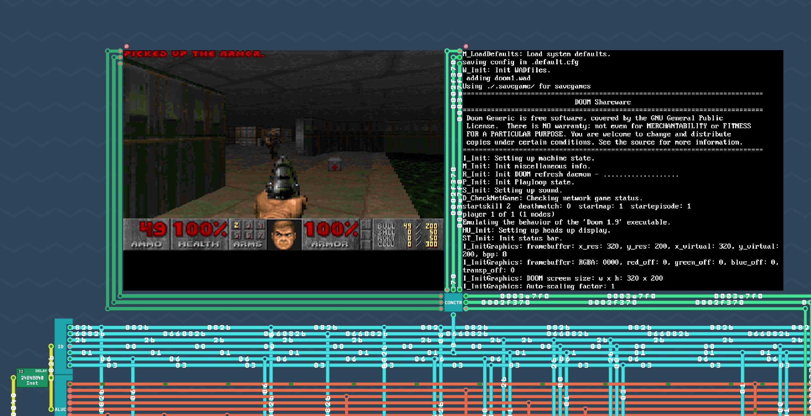
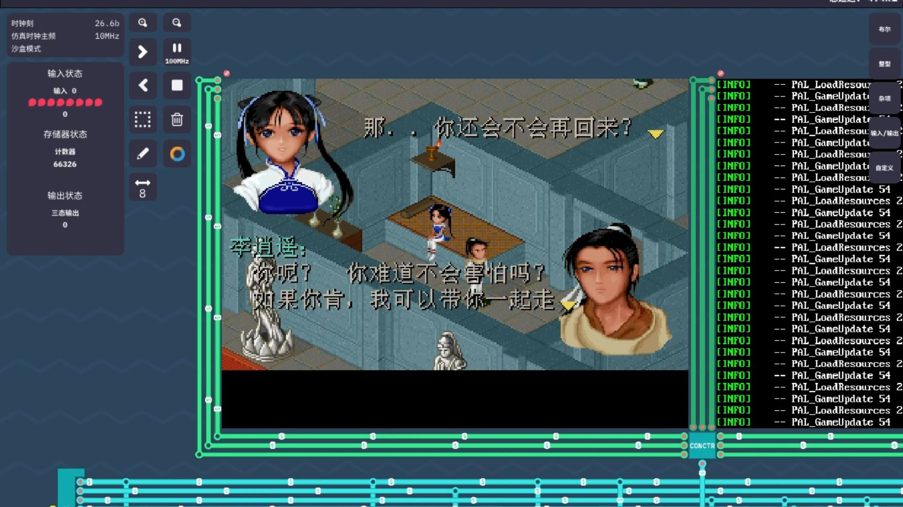
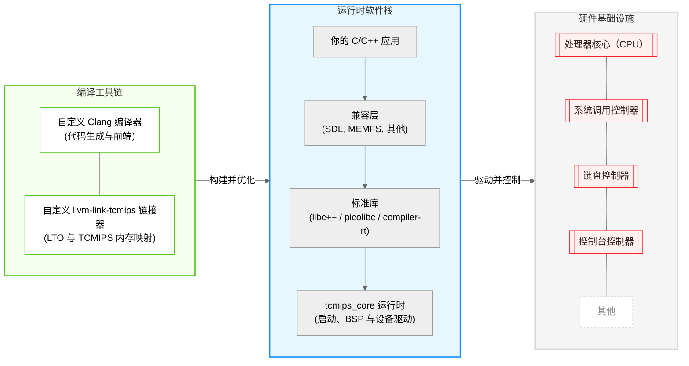

<p align="right">
  <b>简体中文</b> | <a href="./README.en.md">English</a>
</p>

<p align="center">
  
</p>

## TCMIPS

TCMIPS 是面向 `Turing Complete` 沙盒模拟器的一套完整 C/C++ 开发生态：
用普通的标准 C/C++ 编写程序，交叉编译为 `.tcm` 二进制，在游戏内的
自研 32 位 MIPS 兼容 CPU 架构上运行——也可以在附带的桌面模拟器上运行。
下文演示包含 Windows 95（tiny386）、Macintosh（umac）、Doom 与 SDLPAL。

本仓库托管了完整的 TCMIPS 生态：TCMIPS CPU 架构的游戏存档文件、
`tcmips_core` 运行时库、移植的 `picolibc` / `libc++` / `compiler-rt`
标准库，以及由改造版 Clang 编译器与自定义链接器
（`llvm-link-tcmips`）构成的完整交叉工具链。

## 特性

* **修改版 Clang 编译器**：为 TCMIPS 架构特调的 LLVM/Clang 编译器，支持其自定义指令编码、寄存器分配方案与流水线设计。
* **自定义链接器（`llvm-link-tcmips`）**：专用链接器，负责解析目标文件并输出符合游戏内 File Loader 环境格式的 `.tcm` 可执行文件。
* **桌面模拟器**：在宿主机上加载并运行 `.tcm` 镜像，提供像素/text 控制台与键盘渲染、semihost stdio 转发，并附带 GDB/LLDB `mipsel-remote` 调试 stub，支持交互式调试。
* **集成核心库（`tcmips_core`）**：基础运行时库，集成移植的 picolibc、libc++ 与 compiler-rt，为虚拟硬件提供标准 C/C++ 运行时能力、内存分配，以及完整的软件浮点与 64 位整数运算。
* **专用 I/O 系统调用接口**：通过专用 MIPS syscall 为游戏内外设提供接口——关卡 I/O、时间戳、七段数码管、像素/text 控制台、键盘、调色板，以及 semihost stdio 桥接。
* **图形与输入兼容层**：SDL1 / SDL2 兼容层，将 SDL API 映射到架构外设，另附 `libcg` 轻量 2D 图形库——现有 SDL 游戏与演示可低改动移植。
* **内存文件系统（`libtcmips_memfs`）**：基于内存文件系统的 POSIX 风格 BSP 文件层；文件内容由链接器烧写进镜像，运行时通过标准文件操作访问。
* **通用计算库（`libstb`）**：`stb` 系列单头库的 TCMIPS 移植（v2.30/stb_image v2.18/stb_image_resize2 v1.26/stb_truetype v0.67/stb_sprintf v1.10/stb_rect_pack v0.67），包括 PNG 解码、图像缩放、TrueType 字栅化、动态数组、哈希表、格式化输出、矩形打包；纯计算、无外部设备依赖，可低改动集成到游戏内渲染管线。
* **定点数学库（`libfixmath`）**：Q16.16 定点数学库 libfixmath 的 TCMIPS 移植，包括乘法、除法、平方根、三角函数（sin/cos/tan/asin/acos/atan/atan2）、指数/对数、字符串转换。纯整数计算，在无 FPU 硬件上比软件浮点快约 2 倍，适合实时渲染与物理计算。

## 快速开始

1. 准备工具链：从 [GitHub Releases 页面](https://github.com/zhangjiantao/tcmips/releases)下载预编译包并解压到任意位置，如`TCMIPS_TOOLCHAIN_DIR`。
   或自行构建（见[自举构建工具链](#自举构建工具链)）。

2. 构建你的 C/C++ 工程：

   ```shell
   cd /path/to/your/project

   cmake -G Ninja -S . -B build \
     -DCMAKE_BUILD_TYPE=Release \
     -DCMAKE_TOOLCHAIN_FILE="$TCMIPS_TOOLCHAIN_DIR/toolchains/cmake/tcmips.toolchain.cmake"
   cmake --build build
   ```

3. 运行得到的 `.tcm`——从 `/gamesave` 导入存档后经游戏内
   File Loader 加载，或用桌面模拟器运行：

   ```shell
   TCMIPSEmulator <file.tcm>           # 打开窗口；控制台/键盘由宿主机渲染
   TCMIPSEmulator <file.tcm> -hold=0   # guest 程序结束后自动退出
   ```

   guest 的 `printf` 输出与退出码会转发到宿主机（semihost stdio），
   因此模拟器天然适合脚本化运行与测试。需要交互式调试时，可从
   gdb/lldb 连接模拟器内置的 GDB Remote Serial Protocol 服务端
   （`mipsel-remote`）——详见 `emulator/rsp_stub.c`。

## 已知限制

- **C++ 异常不可用**：随附的 libc++ 以 `-fno-exceptions` 交叉编译；
  任何可达的 `throw`/`catch` 路径都会转而调用 `abort()`。请改用
  error-code 风格接口（`std::error_code` 重载、`errno`）。
- **无音频**：SDL1/SDL2 兼容层没有音频后端（stub/dummy 实现），
  因为平台没有音频外设。
- **无线程**：目标为单核机器，不提供线程支持。
- **建议使用 C++17**：随附的 libc++ 对 C++20 仅有部分支持。

## 演示

### 通过 tiny386 启动 Windows 95




### 通过 umac 启动 Macintosh



### Doom



### SDLPAL（palnavy）



更多演示：[Bilibili 视频合集](https://space.bilibili.com/28801454/lists/8407732)

## 仓库结构

- `/tcmips` — 集成运行时库与外设驱动的核心库（`bsp/` 启动与 POSIX 桥接、`dev/` 外设、`lib/` 标准库与兼容层）。
- `/emulator` — 桌面模拟器，在宿主机上加载并运行 `.tcm` 镜像，提供像素/text 控制台与键盘渲染，并附带 GDB/LLDB `mipsel-remote` 调试 stub。
- `/toolchains` — 预编译的交叉工具链、CMake 工具链文件与 sysroot。
- `/tools` — 构建期辅助工具（字体与 logo 生成器）。
- `/test` — 断言式自动化测试（见[自举构建工具链](#自举构建工具链)第 4 步）。
- `/docs` — 架构文档：[ISA](docs/TCMIPS-ISA.md)、
  [内存布局](docs/TCMIPS-MemoryLayout.md)、
  [内存文件系统](docs/TCMIPS-MEMFS.md)、
  [兼容层移植范式](docs/TCMIPS-Porting.md)。
- `/demo` — 示例演示。
- `/gamesave` — TCMIPS 架构的游戏存档文件。

## 技术栈



## 自举构建工具链

本节将从源码构建整个套件本身——编译器、链接器与 sysroot，
仅面向工具链开发。构建 C/C++ 工程不需要它，
直接使用[快速开始](#快速开始)中的预编译工具链即可。

### 1. 构建 LLVM

参考以下仓库构建定制的 LLVM 工具链：

[https://github.com/zhangjiantao/tcmips-llvm](https://github.com/zhangjiantao/tcmips-llvm)

### 2. 部署 LLVM 构建产物

```shell
# 创建目标工具链目录
mkdir -p ./toolchains/llvm/bin

# 拷贝核心编译器与链接器
cp ${LLVM_BUILD_PATH}/bin/clang ./toolchains/llvm/bin/
cp ${LLVM_BUILD_PATH}/bin/clang++ ./toolchains/llvm/bin/
cp ${LLVM_BUILD_PATH}/bin/llvm-link-tcmips ./toolchains/llvm/bin/

# 授予可执行权限
chmod +x ./toolchains/llvm/bin/*
```

### 3. 构建 Sysroot

构建一个最小的 sysroot，为交叉编译提供目标平台的头文件与静态库。

```shell
cmake -G Ninja -S . -B build -DCMAKE_BUILD_TYPE=Release

cmake --build build --target TCMIPS_CORE_ALL
```

### 4. 运行测试

套件自带验证：guest 侧自动化测试通过 semihost stdio 输出结构化的
`[SELF] <名称> PASS/FAIL` 行与退出码（方法论见
[`AUTOTEST.md`](AUTOTEST.md)）。

```shell
# 构建全部 guest 测试套件
cmake --build build --target AUTOTEST_ALL

# 构建桌面模拟器（首次需要）
cmake -S emulator -B build-emulator -DCMAKE_BUILD_TYPE=Release
cmake --build build-emulator --target TCMIPSEmulator

# 逐个运行；所有套件都应以退出码 0 结束
for tcm in build/autotest/*.tcm; do
  build-emulator/TCMIPSEmulator "$tcm" -hold=0
done
```

## 相关仓库

* [https://github.com/zhangjiantao/tcmips-llvm](https://github.com/zhangjiantao/tcmips-llvm)

## 许可证

本仓库原创代码以 MIT 许可证发布——见
[LICENSE](./LICENSE)（其中包含第三方许可附录）。随仓库分发的第三方组件保留其各自的许可证；GPL 许可的演示
（`demo/doom`、`demo/palnavy`，以及 `demo/umac` 中 GPL 派生部分）
不在 MIT 范围内。
